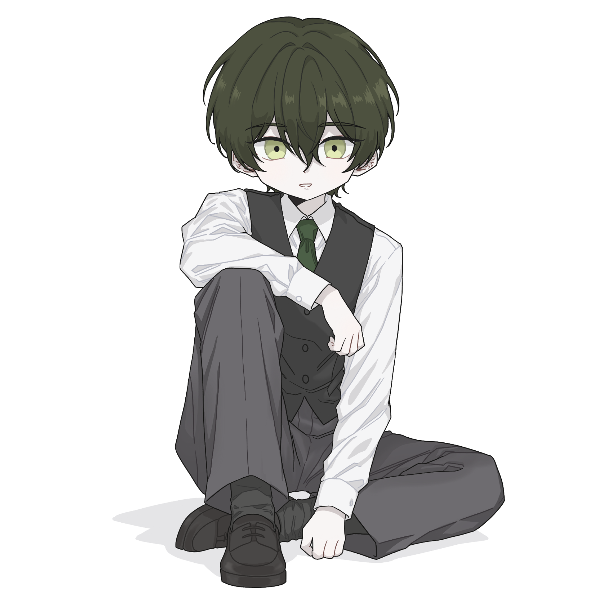

## <b class="c-olive">[ 천상천하 유아독존 ]</b>

> 미리 말하건대, 나는 이 곳에서 제일 가는 자랑거리가 될 거야.

**이름**
필 블랙혼 / Phill Blackhorn

**국적**
미국

**나이**
11세

**키 / 몸무게**  
151cm / 34kg

**외관**

깊은 침엽수림의 그늘, 잘 익은 올리브 열매, 혹은 비에 젖은 이끼를 연상시키는, 빛 바랜 듯한 노란빛이 감추어진 어두운 초록색의 머리카락은 뒷목을 덮은 채 차분히 내려앉아 있다. 세이지의 이파리, 유칼립투스, 혹은 덜 익은 청무화과 껍질 같은 어둑한 파스텔조의 역시 녹색인 눈동자는 장난끼 가득한 눈매 속에 자리를 잡고 있다. 또래보다 키만 웃자란 체구는 제 몸에 맞지 않는 옷을 억지로 꿰어 입은 듯, 팽팽하게 당겨진 교복 바짓단 아래로 껑충하게 자란 다리가 삐져나와 있었다.

또래보다 한두어 살 정도 위로 보이는, 성숙한 인상이 특이점이다. 꽤나 도련님 같은 인상이기도 하여, 출신 구역을 자주 오해받는다.

**성격**
[자유로운], [비상한], [미친개]

**1**

이 놈의 학교는 더럽게 재수 없는 곳에 위치하고 있다. 필 블랙혼은 방금 중앙 각성자 사관학교로 오는 길, 검문소에서 다섯 번째로 윽박지름을 당한 후 팔짱을 꼈다. 참 불퉁한 표정이다. 아무리 내가 유의 구역 출신이래도 너무한 거 아냐? 습관처럼 바닥에 침을 뱉었다 한 대 더 쥐어박혔다. 아 글쎄, 우리네는 상관 없다니까? 앞에 있는 군인 아저씨의 얼굴이 화로 불그락푸르락, 카멜레온처럼 색이 변했다.

필 블랙혼은 간신히 검문소를 통과할 수 있었다. 뒤에서 들려오는 거친 욕설은 무시하도록 하자. 타고나기를 유의 구역에서 규칙 하나 없이 천둥벌거숭이로 산 탓에 어쩔 수가 없다. 그곳에서 보고 자란 건 세계 정부가 파견한 이들이 맞는지 의심이 가는 공교육의 수준과, 야매 폭탄 만드는 법, 소매치기 잘 하는 법, 그외 법을 어길 수 있는 한 모든 것을 어기는 일들 뿐이었다. 좋은 어른? 유의 구역에서는 자기 아이와 함께 살면 그 반열에 들었다. 그러니까 나 정도면 상위 5%란 말이지. 그는 씩 웃었다.

**2**

영아사망률이 아주 먼 옛날, 이형종이 등장하기 한참도 전 중세 시대의 그것과 비슷한 곳에서 필 블랙혼은 6남매 중 둘째로 어떻게 살아남았는가 하면 그의 아주 비상한 머리 덕이라 할 수 있겠다. 각성도 더 전 막 발걸음을 떼었을 때부터 그의 지능은 빛을 발하여 부모나 큰누나가 가뭄에 콩 나듯 등장하는 군인들에게 무언가를 얻어먹을 수 있을 만큼 아픈 체를 할 수 있었다.

그 지능이 5살 때 즈음 하여선 낭중지추요 군계일학이라 할 만큼 숨길 수 없이 뛰어난 것이 눈에 보였다. 유의 구역에서는 똑똑함을 온전히 학습에 쓸 수가 없었기에 더욱 안타까운 일이었다. 그럼 어디에 썼느냐? 당연하게도 밥 벌어 먹는 데 썼다. 사기, 절도, 그외 다수의 지능형 범죄에 사용될 수 밖에 없었다. 그는 6남매 중 다음 가는 맏이였으며, 첫번째 남자 아이였기 때문에 더욱 그랬다. 그의 부모는 앞서 말했다시피 도합 7명이 사는 곳에서 가정을 건사하는 것만으로도 벅찼으며, 큰누나는 알 수 없는 남자와 사랑의 도피를 한 이후 소식을 모른다. 사실상 5명의 동생을 돌봐야 했으니 비상함이 제 자리를 찾기란 힘들었다.

**3**

필 블랙혼은 선택을 해야 했다. 살아갈 것인가? 아니면 주저앉을 것인가. 죽기는 뒤지게 싫던 그는 아득바득 살아남기로 했다. 그러려면 필요충분조건이 하나 있어야 했으니, 바로 제 것에 털 끝 하나라도 건드리면 물어 죽여버리는 개의 습성이었다. 어차피 들개로 살아갈 것, 기왕이면 미친 쪽이 유의 구역의 슬럼에선 더 편하였으니 필 블랙혼은 기꺼이 그리하였다. 엮여서 좋을 꼴은 하나도 보지 못하게, 아무도 나를 해할 수 없게. 늘 가시밭길을 걸어가는 것처럼 온몸의 털을 곤두세우곤 했다.

각성의 계기도 그 때문이었다. 웬 어느 미친 자식들이 다섯 살 배기 동생 세실을 괴롭히고 있던 것이었다. 그 자식들과 본디 사이가 안 좋았던 것도 한몫했겠지만, 어린아이를 건드는 건 비겁한 짓 아닌가. 그 개자식들은 오히려 세실이 안짱다리를 갖고 있다는 것으로 더 심하게 괴롭히기 시작했다. 작열하는 태양, 개자식들의 비열한 웃음, 불쌍한 세실이 세상 떠나가라 우는 소리. 더 이상 참을 수 없었다. 일순간 세상의 모든 것이 필 블랙혼에게로 수렴했다. 그리고 응축된 분노를 발산했다.  
그리고 아무 것도 없었다.

**이능력**
평가 등급 B

### <b class="c-olive">쿠겔블리츠 / Kugelblitz</b>

SI 표준 단위 기준 1칸델라 이상의 **빛이 존재**할 시 빛을 초고밀도로 압축하여 초응축·초질량성 미니 **블랙홀을 생성**한다.
현재 최대 지름이 새끼 손톱 반 정도 크기인 블랙홀을 생성할 수 있다.

블랙홀이 질량의 초고밀도 응축으로 생성되는 것이라면, 질량과 에너지는 동일한 값이므로 에너지인 빛을 응축시켜도 블랙홀이 생성될 수 있다. 이렇게 만들어진 블랙홀은 호킹 복사에 의해 에너지를 발산한다. 그러나 이 에너지와 같은 질량값의 에너지가 블랙홀 생성에 사용되므로, 결과적으로는 블랙홀만이 결과에 남게 된다.

블랙홀에게 계속해서 질량을 공급하여 블랙홀을 유지할 수 있는데, 이 경우에는 공급한 질량만큼 에너지가 발생한다. 이를 알게 된 이후로 사관학교 입학 전까지 한동안 전기 대신 이용한 적이 있다.

**스탯**
체력: ✦✦⟡⟡⟡
근력: ✦⟡⟡⟡⟡
민첩: ✦✦⟡⟡⟡
지능: ✦✦✦✦⟡
정신력: ✦✦✦⟡⟡
총합: 12

**소지품**
붕대
실타래

**특징**
생일: 3월 15일
혈액형: Rh+B형

유의 구역 출신으로, 부모에게 방치되다시피 자랐기 때문에 부랑아 패거리와 어울려 다니며 살아왔다. 그렇기에 고상하게 생긴 겉모습과 달리 입이 아주 거칠고, 싸움 실력도 좋다. 의외로 다혈질이라 욱하는 기질도 있는데, 이는 종종 도를 넘는 폭력을 불러오기도 한다.

겉으로 보이기엔 귀족 소년 같은 이미지. 어울려 다니던 패거리도 기생 오라비라고 불렀을 정도이다.
앞서 서술했지만, 6남매 중 둘째이며 아들 중 맏이이다. 나이 차이가 꽤 나는 큰누나 넬리는 유의 구역의 삶에 질려 벽 안으로 들어가게 해주겠다는 어떤 남자와 사랑의 도피를 한 탓에, 5남매의 실질적 맏형으로서 어릴 적부터 밥벌이는 스스로 해 먹었다. 동생 네 명의 이름은 각각 제너드, 비타, 세실, 에드워드. 막내 에드워드는 무려 갓난배기로, 태어난 지 1년도 채 되지 않았다.

목소리는 또래에 비해 거칠고 낮은 편. 듣다 보면 다소 낯선 감정이 들 정도다.

별명은 기생 오라비, 또는 독종.

마음에 안 드는 일이 있으면 바닥에 발끝을 쿡쿡 찌르며 신발 앞코를 헤지게 만드는 버릇이 있다.

특기는 빠른 추리력과 패턴 인식, 약점 간파, 전략 수립, 문제 해결 능력, 그외 머리 쓰는 대부분의 일들.

자존심을 건들면 무리해서라도 증명하는 타입.

기숙사를 이용하고 있다.

**선관**
.

**텍관**
.
